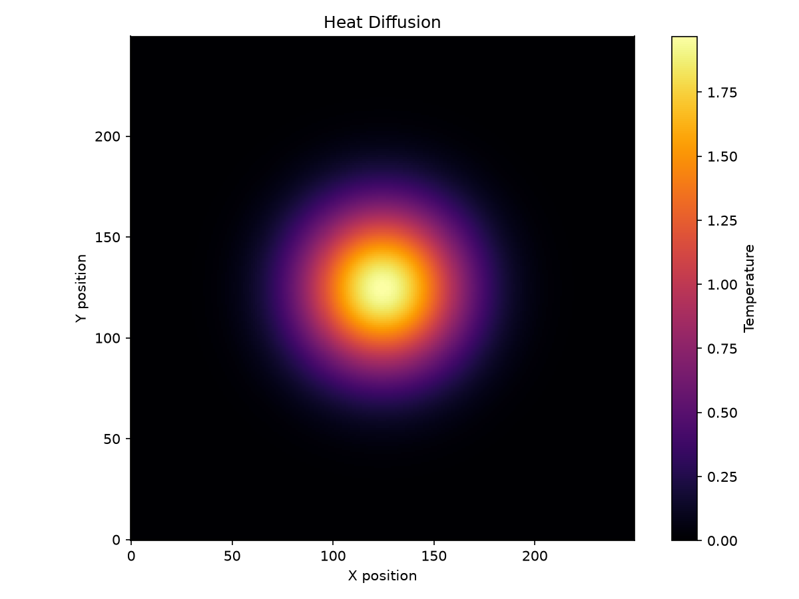
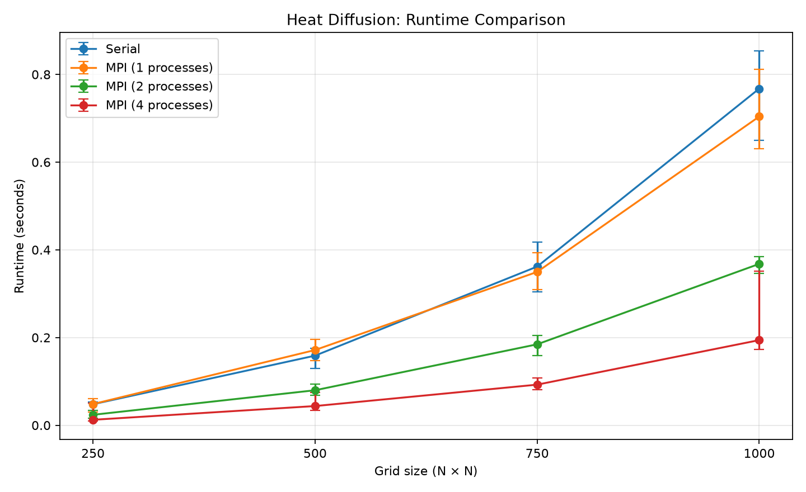
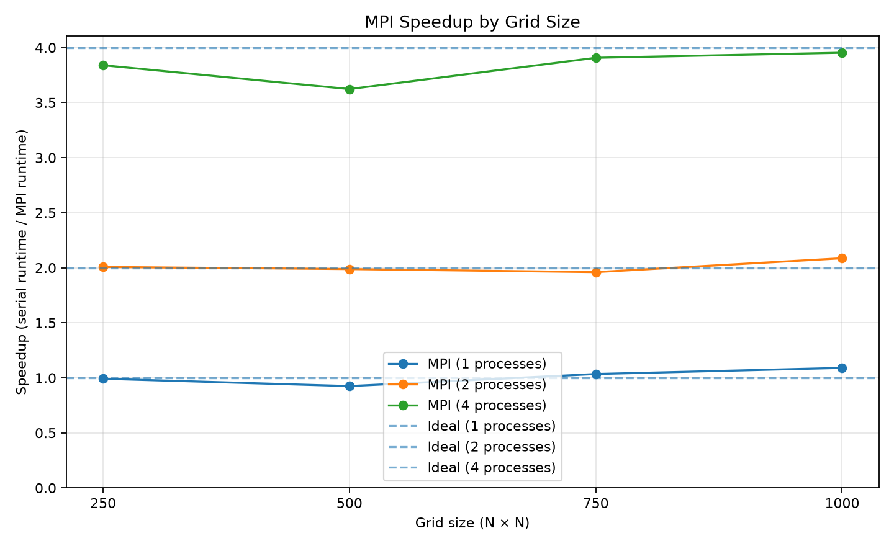

# MPI Heat Diffusion

A C++20 implementation of a two-dimensional heat-diffusion simulation with both a serial solver and an MPI-parallel solver. The project includes automated tests, numerical result comparison, performance benchmarks and Python visualisation tools.

## Features

- Serial heat-diffusion solver.
- MPI solver that distributes grid rows among processes and exchanges boundary (ghost) rows.
- Configurable grid dimensions, iteration count, diffusion coefficient and initial temperature.
- CSV output for result visualisation and numerical comparison.
- Automated tests with CTest, including MPI runs with 1, 2 and 4 processes.
- Repeated performance benchmarks with median runtime, speedup and parallel efficiency.
- Python tools for heatmap visualisation and benchmark plots.
- Continuous integration on GitHub Actions and GitLab CI (build and CTest, including MPI runs).

## Requirements

This project is intended to run on Linux or WSL (Ubuntu).

Required tools:

- A C++ compiler with C++20 support, such as `g++`
- CMake 3.20 or newer
- OpenMPI
- Python 3 and `pip`

Install the C++ dependencies:

```bash
sudo apt update
sudo apt install --no-install-recommends -y cmake g++ openmpi-bin libopenmpi-dev
```

## Build

From the repository root:

```bash
cmake -S . -B build-release \
  -DCMAKE_BUILD_TYPE=Release \
  -DBUILD_TESTING=ON

cmake --build build-release --parallel 2
```

This builds two executables:

- `heat_sim` — serial solver
- `heat_sim_mpi` — MPI-parallel solver

## Run the simulation

### Serial version

Run the default configuration:

```bash
./build-release/heat_sim
```

Run a 500 × 500 simulation and save the final grid to CSV:

```bash
./build-release/heat_sim \
  -n 100 -x 500 -y 500 \
  -a 0.20 -t 100 -s 10 \
  --output serial_results.csv
```

### MPI version

Run the simulation with four MPI processes:

```bash
mpirun -np 4 ./build-release/heat_sim_mpi \
  -n 100 -x 500 -y 500 \
  -a 0.20 -t 100 -s 10 \
  --output mpi_results_4.csv
```

The MPI solver distributes the grid across processes and exchanges neighbouring boundary rows. The final grid is gathered on rank 0, which writes the CSV output.

### Command-line options

| Option | Meaning | Default |
|---|---|---:|
| `-n <iterations>` | Number of simulation time steps | `100` |
| `-x <width>` | Grid width | `1000` |
| `-y <height>` | Grid height | `1000` |
| `-a <alpha>` | Diffusion coefficient, from `0.0` to `0.25` | `0.20` |
| `-t <temperature>` | Initial hot-region temperature | `100` |
| `-s <size>` | Side length of the initial hot region | `10` |
| `-o <file>`, `--output <file>` | Write the final grid to CSV | Disabled |
| `--help` | Print available options | — |

Grid dimensions must be at least 3. The initial hot region must fit inside the grid.

## Tests

Run the test suite after building:

```bash
OMPI_MCA_rmaps_base_oversubscribe=1 \
  ctest --test-dir build-release --output-on-failure
```

CTest runs four tests:

- **`heat_plate_tests`** (serial solver): checks the initial state, a single iteration against hand-computed values (center and four neighbours become 20 for `alpha = 0.20` and an initial temperature of 100), zero iterations, fixed zero boundaries, and input validation (grid smaller than 3, unstable `alpha`, non-finite temperature, hot region that does not fit, out-of-range access, size overflow).
- **`mpi_heat_plate_np1`, `_np2`, `_np4`** (MPI solver on 1, 2 and 4 ranks): runs the MPI solver, gathers the grid on rank 0 and compares every cell with the serial solver (absolute tolerance `1e-12`). The cases use grid sizes whose row count is not divisible by the number of ranks (101 × 97, 17 × 13, 18 × 11) and iteration counts of 23, 1 and 0.

Because the MPI tests compare against the serial solver, CI also guards against regressions in the parallel decomposition and ghost-row exchange.

## Verify serial and MPI results

The automated MPI tests already compare both solvers on small grids. For larger runs you can also compare the CSV outputs manually:

```bash
./build-release/heat_sim \
  -n 100 -x 500 -y 500 \
  --output serial_results.csv

mpirun -np 4 ./build-release/heat_sim_mpi \
  -n 100 -x 500 -y 500 \
  --output mpi_results_4.csv
```

Install the Python dependencies as described in the next section, then run the comparison script:

```bash
python python/compareResults.py
```

The comparison reports the maximum absolute difference between the results and checks numerical agreement within a tolerance. Small floating-point differences can occur, so bit-for-bit equality is not required.

## Python environment

The Python tools use NumPy and Matplotlib. From the repository root:

```bash
python3 -m venv .venv
source .venv/bin/activate

python -m pip install --upgrade pip
python -m pip install -r python/requirements.txt
```

If your virtual environment is already active and the dependencies are installed, you can skip these steps.

## Heatmap visualisation

The heatmap illustrates the final temperature distribution after 2000 simulation iterations on a 250 × 250 grid.

Generate the CSV output:

```bash
mkdir -p results

./build-release/heat_sim \
  -n 2000 -x 250 -y 250 \
  -a 0.20 -t 100 -s 10 \
  --output results/heatmap_input.csv
```

Generate the heatmap:

```bash
python python/plot_heatmap.py \
  results/heatmap_input.csv \
  --save results/heatmap.png
```



The temperature distribution illustrates how heat spreads from the initial hot region over time. The boundaries remain at zero temperature.

## Performance benchmarks

The benchmark scripts compare the serial solver with MPI runs using different process counts.

Build the Release executables before benchmarking.

### Benchmark environment

| Component | Details |
| :--- | :--- |
| CPU | Intel Core i5-12500H (4 performance + 8 efficiency cores, 16 hardware threads) |
| Memory visible to WSL | 7.6 GiB |
| Host OS | Windows 11 (build 26200) |
| WSL | WSL 2 (2.6.1.0), kernel 6.6.87.2-microsoft-standard-WSL2 |
| Distribution | Ubuntu 24.04.3 LTS |
| Compiler | GCC 13.3.0 (`-O3` via CMake Release build) |
| MPI | Open MPI 4.1.6 |
| Build tools | CMake 3.28.3 |
| Python | 3.12.3 |

Notes: WSL 2 reports 8 cores with 2 threads each, but the CPU has a hybrid architecture (performance and efficiency cores). MPI processes were not pinned to specific cores, so placement is decided by the Windows scheduler, which may contribute to run-to-run variance. Measurements were taken on a laptop in a WSL 2 virtual machine and should be understood as indicative rather than as a controlled HPC benchmark.

### Serial benchmark

Run the serial solver for several grid sizes:

```bash
mkdir -p results

python scripts/benchmark.py \
  --executable build-release/heat_sim \
  --sizes 250 500 750 1000 \
  --iterations 100 \
  --repeats 3 \
  --warmups 1 \
  --output results/benchmark_serial.csv
```

### Serial vs. MPI comparison

Run repeated measurements for 1, 2 and 4 MPI processes:

```bash
python scripts/benchmark_compare.py \
  --serial-executable build-release/heat_sim \
  --mpi-executable build-release/heat_sim_mpi \
  --sizes 250 500 750 1000 \
  --iterations 500 \
  --processes 1 2 4 \
  --repeats 10 \
  --warmups 2 \
  --output results/benchmark_comparison_robust.csv
```

The comparison script saves raw measurements to CSV and reports the median, minimum and maximum runtime for each configuration.

For more reliable comparisons, use a Release build, keep the run conditions consistent and avoid competing CPU-intensive workloads. Runtime depends on hardware, available CPU cores, process placement, system load and compiler settings.

## Generating benchmark graphs

The comparison CSV can be visualised using the plotting script:

```bash
python python/plot_benchmark_comparison.py \
  results/benchmark_comparison_robust.csv \
  --out-dir results
```

The script generates two images:

- `results/runtime_comparison.png` — compares median runtime and the observed minimum-to-maximum range.
- `results/speedup_comparison.png` — compares measured MPI speedup with ideal speedup.

### Runtime comparison



### MPI speedup



## Recorded benchmark results

The following measurements were collected in the WSL environment described above using a Release build, 500 iterations per simulation, 2 warm-up runs and 10 measured repetitions. The table reports median runtimes.

| Grid | Serial median | MPI 1 median | MPI 2 median | MPI 4 median | Speedup with 4 processes |
|---|---:|---:|---:|---:|---:|
| 250 × 250 | 47.943 ms | 48.345 ms | 23.883 ms | 12.486 ms | 3.84× |
| 500 × 500 | 158.752 ms | 171.574 ms | 79.850 ms | 43.815 ms | 3.62× |
| 750 × 750 | 361.845 ms | 349.715 ms | 184.594 ms | 92.608 ms | 3.91× |
| 1000 × 1000 | 767.644 ms | 704.011 ms | 367.988 ms | 194.175 ms | 3.95× |

### Speedup with 4 processes: two baselines

| Grid | vs. serial | vs. MPI with 1 process | Efficiency (vs. serial) |
| :--- | ---: | ---: | ---: |
| 250 × 250 | 3.84× | 3.87× | 96.0 % |
| 500 × 500 | 3.62× | 3.92× | 90.6 % |
| 750 × 750 | 3.91× | 3.78× | 97.7 % |
| 1000 × 1000 | 3.95× | 3.63× | 98.8 % |

The speedup is calculated as:

$$
S_p = \frac{T_{\mathrm{serial}}}{T_{\mathrm{MPI},p}}
$$

where $T_{\mathrm{serial}}$ is the serial median runtime and $T_{\mathrm{MPI},p}$ is the MPI median runtime using $p$ processes.

Parallel efficiency is calculated as:

$$
E_p = \frac{S_p}{p}
$$

Speedup relative to the single-process MPI run (to separate parallel scaling from differences between the serial and MPI implementations) is:

$$
S_p^{(1)} = \frac{T_{\mathrm{MPI},1}}{T_{\mathrm{MPI},p}}
$$

### Results interpretation

In these measurements, the four-process MPI solver achieved a speedup between 3.6× and 3.95× over the serial solver, and between 3.6× and 3.9× relative to the single-process MPI run. The two-process version was approximately twice as fast as the serial solver.

With a single process, the MPI executable was slower than the serial executable for the two smaller grids (by up to about 8 % for 500 × 500) and faster for the two larger ones (by up to about 8 % for 1000 × 1000). Since both run the same stencil on one core, this difference points to implementation or measurement effects rather than to MPI itself; it was not investigated further. Speedups relative to the single-process MPI run are therefore listed as well.

Some individual measurements varied considerably, and parallel efficiency relative to the serial solver was slightly above 100 % for some configurations (for example about 104 % for 1000 × 1000 with two processes). Such values are not a guarantee of superlinear scaling; cache effects, scheduling and measurement noise can influence the comparison. Median runtimes are therefore reported instead of best-case times.

The results describe the local test environment and should not be treated as guaranteed performance on other systems.

## Continuous integration

The project is built and tested automatically on two CI systems:

- **GitHub Actions** (`.github/workflows/ci.yml`): Ubuntu 24.04 runner, CMake build, CTest.
- **GitLab CI** (`.gitlab-ci.yml`, [GitLab project](https://gitlab.com/my-projects5070043/mpi-heat-diffusion)): `ubuntu:24.04` container, installs the toolchain and Open MPI, builds in Release mode, and runs CTest (serial test plus MPI runs with 1, 2 and 4 ranks).

Notes: MPI tests use more ranks than the runner may have cores, so oversubscription is enabled via `OMPI_MCA_rmaps_base_oversubscribe`. In the GitLab job the tests run as root inside a throwaway container, which Open MPI only permits with `OMPI_ALLOW_RUN_AS_ROOT` and `OMPI_ALLOW_RUN_AS_ROOT_CONFIRM`.

## Project structure

```text
.
├── .github/workflows/   # GitHub Actions workflow
├── .gitlab-ci.yml       # GitLab CI pipeline
├── include/             # Public C++ headers
├── python/              # Visualisation and analysis tools
├── scripts/             # Benchmark scripts
├── src/                 # Serial and MPI implementations
├── tests/               # Serial and MPI tests
├── results/             # Benchmark data and generated figures
└── CMakeLists.txt       # Build targets and CTest registration
```

## Implementation notes

The grid is updated iteratively using a five-point finite-difference stencil. The MPI implementation distributes rows across processes and exchanges neighbouring boundary rows so that each process can update its local subdomain. The final grid can be gathered on rank 0 and written to CSV.
